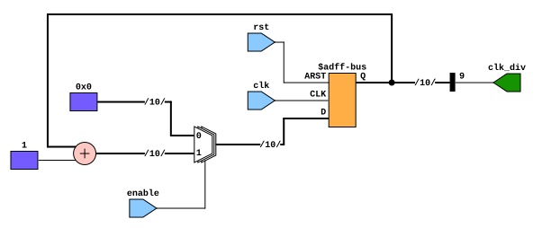
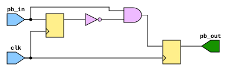
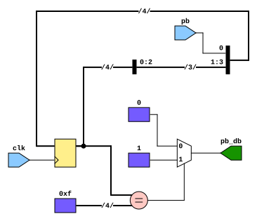
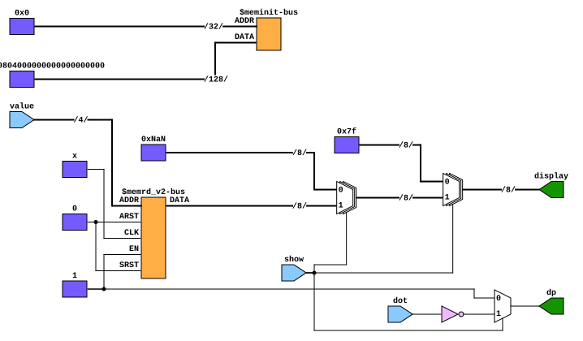
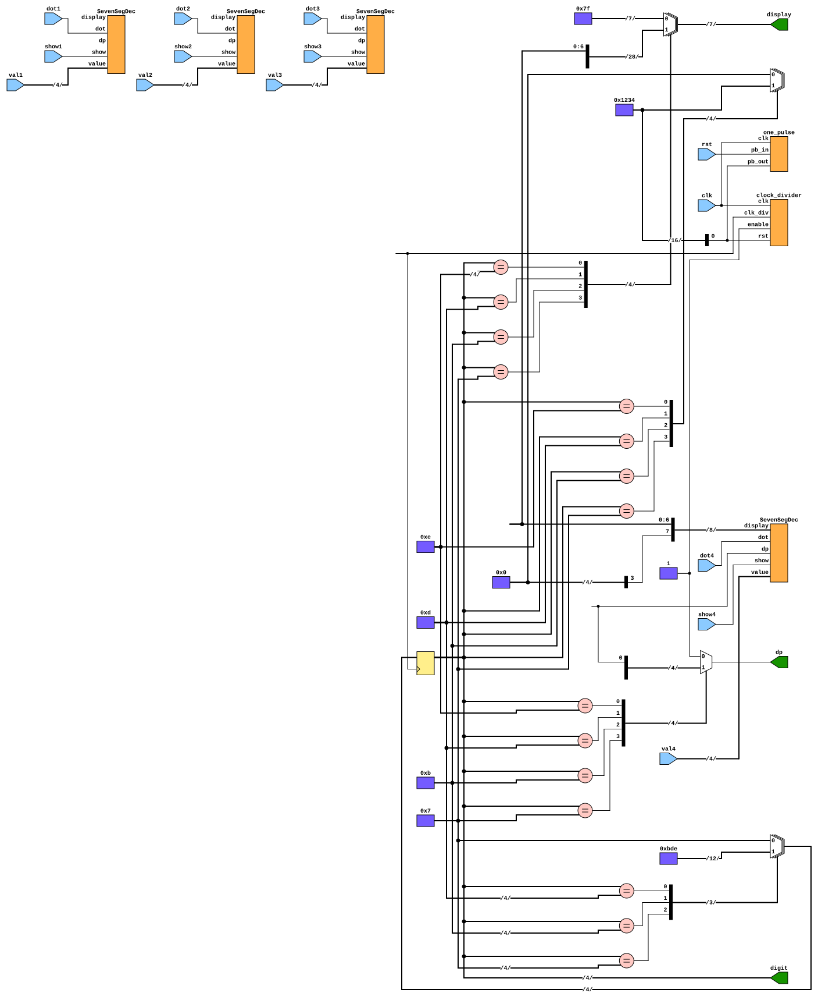
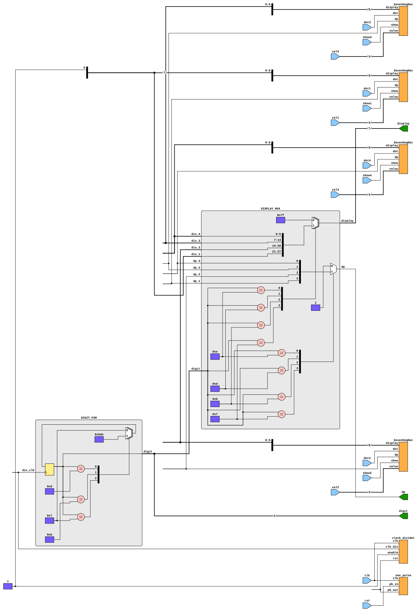
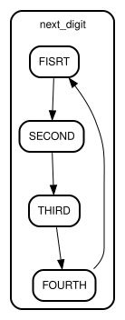

# Hardware-Design-FPGA-Board-Test

## Utils
| 
Diagrams
 |
| --- |
| 
Clock Divider
 |
|  | 
| 
One Pulse Generater
 |
|  |
| 
Debouncer
 |
|  |

## Seven Segments
| 
Diagrams
 |
| --- |
| 
Unit
 |
|  |
| 
Time Multiplexing Handler
 |
|  |
| 
Time Multiplexing Handler (Subs Raw)
 |
|  |
| 
Time Multiplexing Handler FSM
 |
|  |
